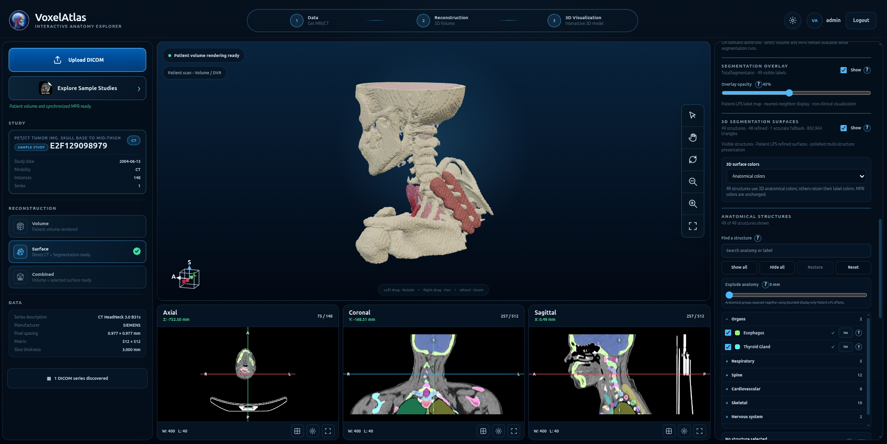
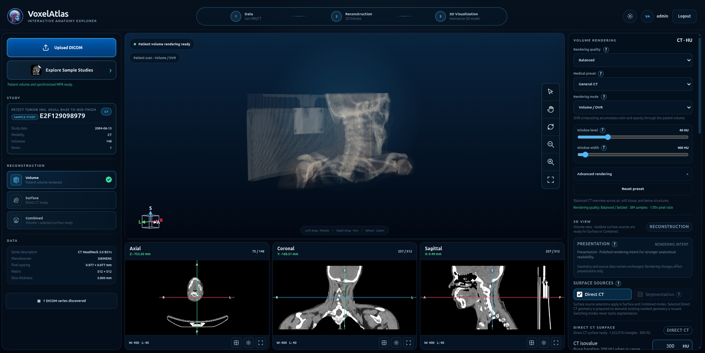
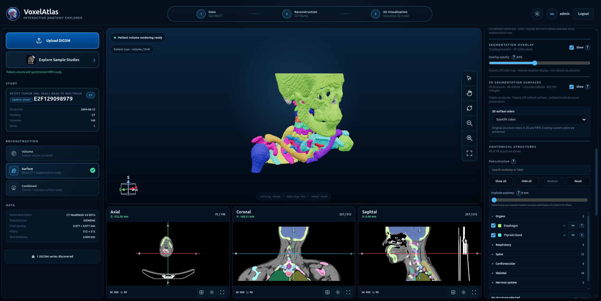
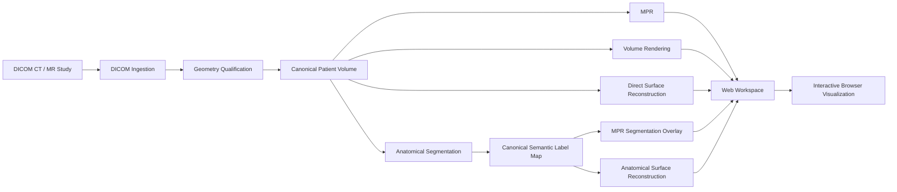

# VoxelAtlas

**Interactive Anatomy Explorer for DICOM CT and MR visualization, anatomical segmentation, and patient-space 3D reconstruction.**

VoxelAtlas is a self-hosted medical-imaging workspace for exploring volumetric CT and MR studies directly in the browser. It combines authenticated DICOM ingestion, synchronized multiplanar reconstruction, GPU volume rendering, surface reconstruction, anatomical segmentation, and interactive 3D visualization in one workflow.

> **Research and engineering software.** VoxelAtlas is not a medical device and is not intended for clinical diagnosis, treatment planning, or patient-care decisions.

<p align="center">
  
</p>

## Overview

VoxelAtlas is built around a patient-specific imaging pipeline:

**DICOM study → canonical patient volume → MPR → reconstruction / segmentation → interactive 3D visualization**

CT and MR studies are reconstructed in physical patient coordinates and can be inspected simultaneously through synchronized axial, coronal, and sagittal views.

The 3D workspace can visualize the source volume directly, derive surfaces from image intensities, or reconstruct individual anatomical structures from semantic segmentation results.

The application keeps scientific data and presentation state separate: display colors, opacity, visibility, clipping, lighting, and presentation profiles do not modify the underlying image volume or segmentation labels.

## Highlights

| Capability | CT | MR |
| --- | :---: | :---: |
| DICOM study ingestion | ✓ | ✓ |
| Study and series discovery | ✓ | ✓ |
| Geometry qualification | ✓ | ✓ |
| Canonical patient-space volume | ✓ | ✓ |
| Axial / coronal / sagittal MPR | ✓ | ✓ |
| Window / intensity controls | ✓ | ✓ |
| Interactive 3D visualization | ✓ | ✓ |
| Direct volume rendering | ✓ | ✓ |
| Direct surface reconstruction | ✓ | ✓ |
| Anatomical segmentation | ✓ | ✓ |
| Segmentation overlays in MPR | ✓ | ✓ |
| Structure-level 3D surfaces | ✓ | ✓ |
| Semantic anatomical coloring | ✓ | ✓ |
| Per-structure visibility and opacity | ✓ | ✓ |
| Patient-space clipping | ✓ | ✓ |
| Curated sample-study workflow | ✓ | ✓ |

Segmentation availability depends on the configured model runtime and installed model assets.

## Medical Imaging Workspace

VoxelAtlas keeps 2D and 3D representations of the same study synchronized inside a single browser workspace.

<p align="center">
  
</p>

The workspace includes:

- axial, coronal, and sagittal multiplanar reconstruction;
- image-registered crosshairs and synchronized navigation;
- physical patient-space orientation;
- CT window level and window width controls;
- modality-aware intensity presentation;
- direct volume rendering;
- MIP, MinIP, average-intensity, slice, and slab visualization modes;
- interactive orbit, pan, zoom, reset, and auto-rotation;
- patient-space clipping controls;
- rendering-quality controls;
- reconstruction-source selection;
- study and processing status.

## Anatomical Segmentation

Semantic segmentation is integrated directly into the imaging workspace rather than being presented as a separate viewer.

<p align="center">
  
</p>

Segmentation results can be represented as:

- colored overlays on all three MPR planes;
- independently reconstructed anatomical surfaces;
- searchable structure labels;
- anatomical grouping;
- per-structure visibility;
- structure isolation;
- opacity control;
- semantic anatomical colors;
- reversible presentation-color modes;
- bounded multi-structure 3D visualization.

The semantic label map remains separate from its visual representation. Changing colors, opacity, visibility, clipping, or presentation profiles does not alter segmentation labels.

## Reconstruction Modes

### Volume

The original image volume can be visualized directly through GPU-based volume rendering. For CT studies, physical Hounsfield-unit semantics are preserved and exposed through medical transfer-function and windowing controls.

### Direct Surface

A surface can be reconstructed directly from the source volume without semantic segmentation. This provides a geometric representation when anatomical label identity is not required.

### Segmentation Surfaces

Semantic label maps can be converted into individual patient-space anatomical meshes. Each structure preserves its semantic identity and can be controlled independently in the 3D scene.

### Combined Visualization

Voxel and surface representations can coexist when both source-image context and explicit geometry are useful.

## CT Workflow

The CT pipeline supports:

1. authenticated DICOM ingestion;
2. Study / Series discovery;
3. slice-order and geometry qualification;
4. canonical `float32` patient-volume construction;
5. Patient LPS spatial provenance;
6. synchronized multiplanar reconstruction;
7. CT windowing and medical transfer functions;
8. direct GPU volume rendering;
9. patient-space clipping;
10. direct CT surface reconstruction;
11. TotalSegmentator anatomical segmentation;
12. canonical semantic label-map import;
13. synchronized segmentation overlays;
14. individual anatomical 3D surfaces;
15. semantic anatomical presentation.

## MR Workflow

The MR pipeline supports:

1. DICOM MR ingestion;
2. geometry qualification and canonical volume construction;
3. synchronized patient-space MPR;
4. direct volume visualization;
5. direct MR surface visualization;
6. qualified MR anatomical segmentation;
7. canonical semantic label-map import;
8. colored segmentation overlays;
9. individual anatomical 3D surfaces;
10. semantic anatomical presentation.

MR segmentation uses an isolated model runtime when configured so heavyweight model dependencies do not become part of the lightweight application runtime.

## Architecture



VoxelAtlas deliberately isolates computationally heavy processing from the interactive web application where appropriate.

The main repository structure is:

```text
voxel-atlas/
├── backend/
│   └── voxelatlas/       Application and medical-imaging backend
├── web/                  Browser workspace and 3D visualization
├── tests/                Unit, integration and regression tests
├── scripts/              Verification and development utilities
├── requirements/         Python dependency profiles
├── docs/                 Architecture and engineering documentation
└── .env.example          Development configuration reference
```

## Technology Stack

### Backend

- Python
- FastAPI
- NumPy
- pydicom
- Argon2id authentication
- isolated worker processes for heavyweight processing

### Medical Imaging

- DICOM CT and MR
- canonical patient-space volumes
- DICOM Patient LPS geometry
- multiplanar reconstruction
- medical intensity presentation
- surface reconstruction
- semantic label maps

### Segmentation

- TotalSegmentator
- CT anatomical segmentation
- MR anatomical segmentation
- canonical label-map validation
- structure-level 3D reconstruction

### Visualization

- Three.js
- WebGL / WebGL2
- GPU volume rendering
- patient-space surfaces
- synchronized MPR overlays
- interactive clipping and presentation controls

## Quick Start

```bash
git clone https://github.com/3nK1i/voxel-atlas.git
cd voxel-atlas

python3 -m venv .venv
source .venv/bin/activate
pip install -r requirements/backend.txt

export PYTHONPATH="$PWD/backend"
```

VoxelAtlas requires explicit authentication and session configuration. `.env.example` documents the available development settings.

For local development, configure `VOXELATLAS_ENV`, a session secret, allowed hosts, authentication username, and an Argon2id password hash before launching the application.

> Advanced surface reconstruction and anatomical segmentation require their corresponding optional runtimes and model assets.

## Configuration

| Variable | Purpose |
| --- | --- |
| `VOXELATLAS_ENV` | Application environment |
| `VOXELATLAS_SESSION_SECRET` | Session-signing secret |
| `VOXELATLAS_SECURE_COOKIES` | Require HTTPS-only session cookies |
| `VOXELATLAS_SESSION_COOKIE_NAME` | Session cookie name |
| `VOXELATLAS_SESSION_TTL_MINUTES` | Session lifetime |
| `VOXELATLAS_ALLOWED_HOSTS` | Accepted HTTP host names |
| `VOXELATLAS_DATA_DIR` | Application data directory |
| `VOXELATLAS_MAX_UPLOAD_MIB` | Maximum accepted upload size |
| `VOXELATLAS_AUTH_USERNAME` | Authentication username |
| `VOXELATLAS_AUTH_PASSWORD_HASH` | Argon2id password hash |
| `VOXELATLAS_SURFACE_PYTHON` | Optional isolated surface-reconstruction runtime |

Never commit populated environment files, plaintext credentials, session secrets, private model credentials, or patient data.

## Security

VoxelAtlas is designed as a controlled, self-hosted application.

The backend includes protections around authenticated access, opaque server-side sessions, Argon2id password verification, session expiration and revocation, allowed-host validation, same-origin request handling, bounded request and upload sizes, security-oriented HTTP headers, bounded authentication work, and isolated heavyweight processing.

Production deployments should use TLS through a trusted reverse proxy and explicitly configure trusted hosts, secure cookies, session secrets, authentication credentials, and persistent-data permissions.

## Data Privacy

DICOM studies may contain sensitive patient information.

Before working with real medical data:

- follow the privacy and information-security requirements applicable to your environment;
- de-identify studies when appropriate;
- restrict access to the application and its data directory;
- use HTTPS in production;
- protect persistent processing artifacts;
- never commit patient DICOM data to the repository.

Sample studies should use public, approved, or appropriately de-identified data.

## Scientific and Geometric Integrity

### Preserve patient geometry

DICOM orientation, spacing, slice ordering, and patient-space transforms are treated as explicit reconstruction inputs.

### Keep source data immutable

Visualization derivatives must not silently modify the canonical patient volume or semantic segmentation label map.

### Separate computation from presentation

Colors, opacity, lighting, clipping, visibility, camera state, and presentation profiles affect visualization rather than the scientific source representation.

### Preserve provenance

Derived volumes, label maps, and surfaces remain bound to their source study and processing configuration.

### Fail explicitly

Malformed, inconsistent, unsupported, or unqualified inputs should fail rather than silently produce plausible-looking but incorrect geometry.

## Testing

The repository contains automated coverage for authentication and security boundaries, DICOM ingestion, geometry qualification, canonical patient-volume construction, multiplanar reconstruction, volume rendering, patient-space clipping, segmentation lifecycle and provenance, canonical label-map import, semantic MPR overlays, anatomical surface generation, surface refinement, CT and MR workflows, and browser visualization contracts.

Tests are located under `tests/`.

## Engineering Documentation

Detailed architecture, qualification records, and historical implementation notes are retained under `docs/`.

The historical records document how individual subsystems were introduced and validated. They are not required reading for normal use of the application.

## Current Scope

VoxelAtlas focuses on CT and MR image exploration, patient-specific volumetric visualization, multiplanar reconstruction, direct surface visualization, semantic anatomical segmentation, structure-level 3D reconstruction, and engineering/research workflows.

It is not intended to replace a PACS, radiology reporting platform, certified diagnostic workstation, or clinical treatment-planning system.

## Contributing

Contributions that improve correctness, robustness, performance, interoperability, visualization, testing, or documentation are welcome.

For substantial changes:

1. keep the change narrowly scoped;
2. preserve patient-space and modality semantics;
3. add or update regression coverage;
4. document new runtime or model requirements;
5. keep heavyweight dependencies isolated where practical;
6. never include credentials, patient data, or machine-specific configuration.

When reporting imaging issues, use anonymized, synthetic, or publicly redistributable data whenever possible.

## Acknowledgements

VoxelAtlas builds on the open-source medical-imaging, scientific Python, and web-visualization ecosystems.

Notable technologies used by the project include TotalSegmentator, pydicom, NumPy, FastAPI, and Three.js.

Third-party libraries, models, datasets, and bundled assets remain subject to their respective licenses and terms.

## License

VoxelAtlas is licensed under the [Apache License 2.0](LICENSE).

## Disclaimer

VoxelAtlas is provided for software engineering, visualization, research, and educational purposes.

It is **not a medical device** and is **not intended for diagnosis, treatment planning, clinical decision-making, or other patient-care use**.

Users are responsible for validating the software, model runtimes, datasets, security controls, and deployment environment for their intended application.
